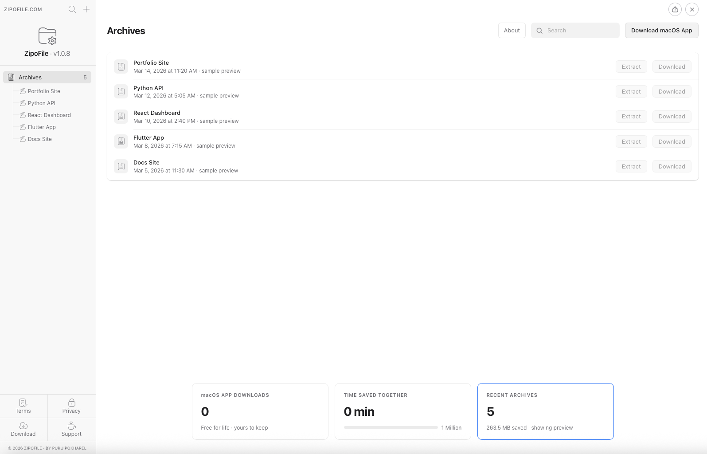

# ZipoFile

Web app for [zipofile.com](https://zipofile.com). Version **1.0.10**.

Site: product + downloads + updater (`/downloads`).  
This repo: frontend source.  
macOS build: [Releases](https://github.com/purupokharel/zipofile/releases/tag/v1.0.10) (`ZipoFile_1.0.10.dmg`, Intel & Apple Silicon).



```bash
npm install
ZIPOFI_ALLOW_STALE_DMG=1 npm run build
npm run preview
```

## About ZipoFile

### What ZipoFile does

ZipoFile makes a .zip of a project folder and leaves out dependency, cache, build, version-control, and editor folders. Those folders can be recreated from the project's own files (package.json, requirements.txt, Cargo.toml, and so on) and often hold most of a project's files.

### How to use it

- Click **Add Project**.
- Type a project name, or leave it blank to use the folder's name.
- Click **Pick Folder & Archive** and choose the folder.
- The archive is added to **Your Archives** with its name and the date it was made, newest first.

### Folders left out, by stack

Each name below is matched at any depth in the folder. Names without a condition are skipped in every project, whatever its stack.

- **Node.js and other JavaScript projects (React, Vue, Vite, etc.):** node_modules, bower_components, .pnpm-store, dist, build, coverage, .nyc_output, .cache, .parcel-cache
- **Monorepo tools:** .turbo (Turborepo), .nx (Nx)
- **JavaScript frameworks:** .next (Next.js), .nuxt and .output (Nuxt), .svelte-kit (SvelteKit), .expo (Expo), .angular (Angular), .docusaurus (Docusaurus)
- **Python:** .venv, venv, __pycache__, .pytest_cache, .mypy_cache, .ruff_cache, .tox, .nox, .ipynb_checkpoints, .eggs, .hypothesis, any folder whose name ends in .egg-info, and any folder that contains a pyvenv.cfg file (a virtual environment with any name, such as env)
- **Rust:** target
- **Java with Maven:** target
- **Java, Kotlin, and Android with Gradle:** build, .gradle, .kotlin, .cxx, .externalNativeBuild
- **Swift and Xcode:** DerivedData, .swiftpm, .build, Pods, Carthage
- **Dart and Flutter:** .dart_tool, .pub-cache, build
- **Go:** vendor, only when it contains modules.txt
- **PHP:** vendor, only when the folder that holds it also has composer.json
- **Ruby:** bundle inside a vendor folder (vendor/bundle), and .bundle only when the folder that holds it also has a Gemfile
- **.NET:** bin and obj, only when the folder that holds them also has a .csproj, .fsproj, .vbproj, or .sln file
- **Other tools:** .terraform (Terraform), .serverless (Serverless Framework), elm-stuff (Elm), .sass-cache (Sass)
- **Version control:** .git, .hg, .svn
- **Editors:** .vscode, .idea

A folder you made yourself named build, dist, target, coverage, or any other name in this list without a condition is also left out. Folders named env, vendor, bin, obj, or bundle are kept unless their condition above is met.

### Files left out

- .env and every .env.* file (for example .env.local and .env.production), so credentials are not copied. These templates are kept: .env.example, .env.sample, .env.template, .env.dist.
- .DS_Store, Thumbs.db, desktop.ini

### What is kept

Every other file and folder, including dotfiles and dot-folders such as .github, .husky, .gitignore, .eslintrc, and .npmrc. The folder you pick is always archived, even if its own name is in the list above.

The built-in list cannot be changed. To leave out anything else, such as a large log folder, a bundled runtime, or key files, use the skip list below.

### Your own skip list

In **Add Project**, the optional **Also skip** field adds patterns for that archive, on top of the rules above.

- Enter one pattern per line, or separate them with commas.
- A name without / (for example logs or *.pem) skips every file or folder with that name, at any depth.
- A pattern with / (for example runtime/forensics or /data) is a path from the picked folder. Only that path is skipped.
- A trailing / (for example tmp/) matches folders only.
- * matches any characters within a name, ? matches one character, and ** matches any number of folders (for example **/fixtures/*.bin).
- Matching is case-sensitive. Lines starting with # are ignored.
- Rejected: patterns with .., . or empty path parts, a backslash, or a drive letter, and * or ** on their own. Patterns only match paths inside the picked folder. Up to 100 patterns of up to 256 characters.

A skipped folder is not opened, the same as with the built-in rules. In Safari and Firefox the browser has already listed it before ZipoFile filters (see Platforms).

If the picked folder contains a file named .zipofiignore, its lines are added to the skip list with the same rules, one pattern per line. Commas are not separators in that file, invalid lines in it are ignored, and ! (negation) is not supported. The .zipofiignore file itself is archived.

The patterns from the field are saved with the archive and shown under its name in **Your Archives**. There is no re-archive button: to archive the same folder again, use **Add Project** and enter the patterns again.

### How files are stored

Every file is stored without compression (zip method 0), with its modification time, so no time is spent compressing. The macOS app lists folders on up to 16 threads and reads up to 32 files at once (two per processor thread), and it starts reading while the folder is still being listed. The web app reads up to 16 files at once. The macOS app writes files in the order of a sorted walk of the folder, so the same unchanged folder gives a byte-for-byte identical archive. The web app writes them in the order the browser lists them.

Each file has two zip headers that both contain its path. No other extra fields are written, except Zip64 fields, which are added only when an archive has 65,535 or more entries, holds a file of 4 GB or more (macOS app only), or passes 4 GB. With hundreds of thousands of small files the headers add up: in the example below they made the archive about 25% larger than the files. The macOS app also keeps folders that end up empty, with their modification time; the web app stores files only. Any standard unzip tool can open the archive.

### Where archives are saved

**macOS app:** archives are written to ~/Library/Application Support/com.zipofi.app/archives/ as \<project name\>_\<id\>.zip. The list of archives is saved in projects.json in ~/Library/Application Support/com.zipofi.app/. **Show Path** displays where an archive is. **Unzip** asks for a destination folder, restores file permissions (scripts such as gradlew stay executable), and refuses any entry that would be written outside that folder. Symbolic links in the project are not followed and not stored.

**Web app:** archives are saved in this browser's IndexedDB storage on this device and count against the browser's storage limit for the site. Clearing the site's data deletes them. **Download** saves \<project name\>.zip. **Unzip** in Chrome and Edge asks for a folder and writes the files into it. Safari and Firefox cannot write to a folder, so Unzip downloads the .zip instead. Browsers do not give web pages file permissions, so executable permissions are not kept in web archives.

There is no Remove button in either version yet.

### Platforms

- **macOS app:** the **Download** menu at the top of this page links to a universal build for Intel and Apple Silicon Macs (a .dmg file of about 7 MB). It is signed with an Apple Developer ID certificate and notarized by Apple, with the notarization ticket stapled to both the app and the .dmg, so Gatekeeper accepts it, also offline. macOS may still ask once to confirm opening an app downloaded from the internet. It has been run on an Intel Mac only, not yet on Apple Silicon. From version 1.0.1 the app checks ZIPOFILE.COM for a newer version when it starts. An update is installed only if its signature matches the key built into the app, and the app then asks to restart.
- **Windows and Linux:** listed as planned in the Download menu. No builds are available.
- **Web app in Chrome and Edge:** ZipoFile walks the folder itself and does not list or read anything inside excluded folders, so files in node_modules and the other folders above are never read. For a folder with a condition, it only checks whether the marker file exists.
- **Web app in Safari and Firefox:** the browser reads the list of every file in the chosen folder, including everything in node_modules, before ZipoFile can filter it. With large dependency folders this step is slow. The archive contents are the same as in Chrome and Edge.

The web app loads every kept file and the finished archive into memory. For very large projects, the macOS app is the better choice.

### Measured example

Test folder: a Python web app with two small React experiments, 641 MB in 534,355 files. Most are small log and data files, 415,159 of them in one log folder. Machine: one Intel iMac (Xeon W-2140B, 8 cores and 16 threads, 32 GB RAM), with the files already in the disk cache. ZipoFile times are the median of 5 runs, with the range in brackets.

- Default rules: ZipoFile left out 5,405 files (99.4 MB) and kept 528,950 files (541.6 MB). macOS app: 15.3 seconds (15.2 to 17.1). Archive: 679.2 MB.
- Default rules plus one skip-list path for the log folder: ZipoFile kept 113,791 files (451.5 MB). macOS app: 6.2 seconds (6.1 to 6.4). Archive: 482.1 MB.
- The web app's archiving code, run in Node.js on the same machine with default rules: 1 minute 51 seconds (1:47 to 2:27). Speed in a real browser was not measured.
- zip -r -0 (no compression) on the whole folder, run twice: 1 minute 36 seconds and 1 minute 47 seconds. Archive: 862.6 MB.
- zip -r (with compression) on the whole folder, measured earlier the same day: 2 minutes 11 seconds. Archive: 355.6 MB.

With default rules, the macOS app was about 6 to 7 times faster than zip -r -0 on this folder, mostly because it lists folders and reads files on many threads at once. On this machine, opening 528,950 files alone took about 10 seconds even with 32 threads, so most of the remaining time is the operating system opening files. Only 1% of the files were in excluded folders. The web app's code was about as fast as zip -r -0. Times depend on the project, the disk, and the machine.
