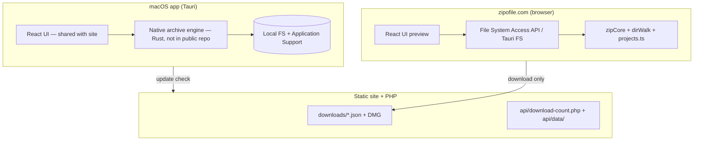
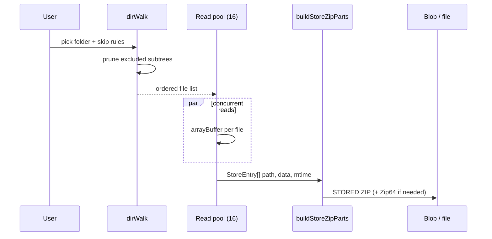
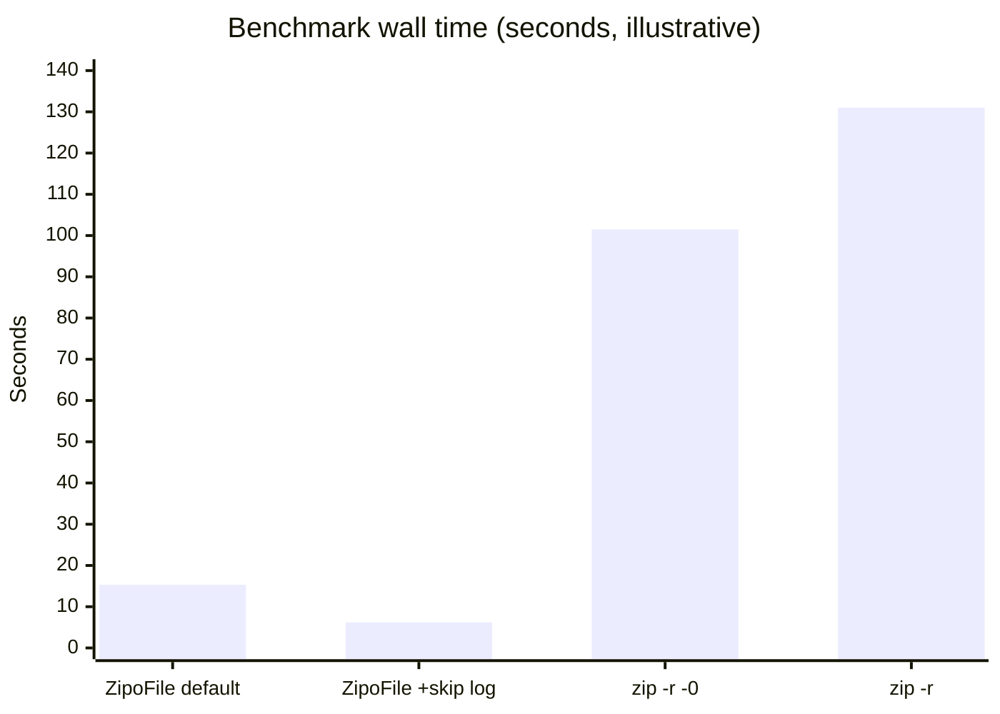

# ZipoFile: A Technical Case Study

**Document type:** Engineering case study (research-style narrative)  
**Product:** ZipoFile macOS application and [zipofile.com](https://zipofile.com)  
**Public release referenced:** 2.1 (October 2026)  
**Repository scope:** This document is written against the **public** `zipofile.com` source tree. The shipped macOS binary is built with Tauri/Rust tooling that is **not fully published** in that tree; where behavior is documented in-product but not inspectable here, that limitation is stated explicitly.

---

## Abstract

ZipoFile archives local project folders into ZIP files while applying stack-aware exclusion rules so dependency, cache, build, and version-control trees are omitted by default. The design favors **store mode** (ZIP compression method 0): no DEFLATE work, deterministic output, and throughput dominated by filesystem metadata and I/O rather than CPU compression. A parallel **walk-then-read** pipeline overlaps directory enumeration with concurrent file reads (16 workers in the shared TypeScript path; the in-app About sheet describes up to 16 listing threads and 32 concurrent reads on the native macOS build).

On the **same ~1.23 GB** mixed Python / Next.js / PHP / HTML project (verified October 2026), ZipoFile archived in **under one second** on both **Apple Silicon** and **Intel Mac**. macOS **Compress** on that folder took **about 12 seconds** on Apple Silicon and **about one minute** on Intel. A separate **Intel iMac** benchmark (641 MB on disk, 534 355 files, warm cache) measured a **median of 15.3 s** for ZipoFile versus **96–107 s** for `zip -r -0` over the **entire** folder. These figures are **not** guarantees for every disk or layout. This case study explains the architecture, algorithms, measurement methodology, extrapolations, and known limits with enough detail for independent scrutiny.

---

## 1. Problem framing

### 1.1 User goal

Developers frequently need a **portable snapshot** of a repository (handoff, backup, air-gap copy) without shipping reproducible dependency trees (`node_modules`, virtual environments, `.git`, build artifacts). macOS **Compress** (Archive Utility) archives **everything selected**, typically with **compression**, and does not apply project-specific exclusion semantics.

### 1.2 Design goals (observable in code and docs)

| Goal | Mechanism |
|------|-----------|
| Skip non-portable bulk | `exclude-rules.json` + conditional markers + `.zipofiignore` / per-archive skip list |
| Maximize throughput | Store mode; parallel reads; prune directory walk at exclude boundaries |
| Predictable archives | Sorted walk order; fixed STORED method; documented Zip64 thresholds |
| Local-first privacy | No upload of project bytes in the macOS app; site is preview + distribution |
| Verifiable releases | `sourceHash` in `release.json`; signed/notarized DMG; updater signature checks |

### 1.3 Non-goals (honest scope)

- **Not** a replacement for `git archive` or package registries for dependency reproducibility.
- **Not** optimized for single multi-gigabyte files (web writer rejects ≥4 GB per entry; native path documented separately).
- **Not** cross-platform shipped yet (Windows/Linux listed as planned).

---


## 2. System architecture

### 2.1 High-level components



The **same React application** (`src/App.tsx`, styles, sheets) ships inside the Tauri shell and as the static site. Archiving on the **website preview does not run** for end users; `zipofile.com` demonstrates UI and distribution.

### 2.2 Data flow for one archive (TypeScript path — auditable)

This path is what `npm run bench` exercises and what tests in `tests/zip.test.ts` cover.



**Concurrency constant (web/Tauri UI path):**

```17:17:src/lib/projects.ts
const READ_CONCURRENCY = 16;
```

**Store mode in worker (browser zip path):**

```41:41:src/workers/zip.worker.ts
  zip(store, { level: 0 }, (err, data) => {
```

**Native macOS path (documented, not in public Rust sources):** About sheet states 16 folder-listing threads, 32 concurrent file reads, overlap of listing and reading. Treat that as **product documentation** until the Rust implementation is published.

---

## 3. Exclusion model

### 3.1 Why exclusions dominate “5 GB project” comparisons

Let \(S\) be on-disk size of the selected folder and \(A\) the aggregated size of **included** files after rules. Generally \(A \ll S\) for typical repos:

\[
\text{time} \propto f(N, A, \text{metadata})
\]

where \(N\) is included file count. ZipoFile reduces both \(N\) and \(A\) before reading; macOS Compress on the same selection processes \(S\) and \(N_\text{all}\).

Excludes are applied during `walkDirectoryHandle`: excluded directories are **not descended**, so `node_modules` with millions of entries may cost **one** `stat`/directory boundary check instead of millions of opens.

### 3.2 Rule sources (precedence)

1. Built-in rules (`src/lib/exclude-rules.json`, logic in `src/lib/excludes.ts`)
2. `.zipofiignore` in project root (`readIgnoreFromHandle`)
3. Per-archive “Also skip” field (`skipList.ts`, max 100 patterns)

Tests in `tests/excludes.test.ts` and `tests/skipList.test.ts` lock behavior.

### 3.3 Security-related file excludes

`.env` and `.env.*` (except templates) are skipped to reduce credential leakage risk—documented in About; not a substitute for human review before sharing an archive.

---

## 4. ZIP format and implementation techniques

### 4.1 Store mode (method 0)

For entry \(i\) with uncompressed size \(s_i\), STORED archives pay:

- Local header + filename UTF-8
- Raw bytes \(s_i\)
- Central directory record (duplicate path metadata)

CRC-32 (IEEE) is still computed. Implementation uses a **slice-by-8 CRC table** for throughput:

```25:44:src/lib/zipCore.ts
/** CRC-32 (IEEE), slice-by-8. */
export function crc32(d: Uint8Array): number {
  const t = CRC_TABLE;
  let c = 0xffffffff;
  // ...
}
```

**Design trade-off:** Archive size grows versus `zip -r` (compressed), especially for text-heavy trees; wall time usually falls when CPU would have spent cycles on DEFLATE.

### 4.2 Zip64

`buildStoreZipParts` emits Zip64 end records when entry count ≥ 65 535, per-file size ≥ 4 GiB, or total archive size crosses 4 GiB (see `zipCore.ts` header comment). `tests/zip.test.ts` includes a Zip64 entry-count stress case.

**Web path limit:** single entry ≥ 4 GiB throws (message directs user to macOS app)—see `zipCore.ts` around the `size >= U32` check.

### 4.3 Deterministic ordering

Walk produces paths in sorted order; archive byte layout is stable for unchanged trees (About sheet). That aids regression testing and content-addressed comparisons (`source-hash.mjs` for releases).

### 4.4 Header overhead (measured anecdote)

In the benchmark folder, **679.2 MB** archive vs **541.6 MB** included payload ≈ **25.4%** overhead:

\[
\text{overhead} = \frac{679.2}{541.6} - 1 \approx 0.254
\]

With hundreds of thousands of small files, duplicate path strings in local and central headers dominate—expected ZIP behavior, not a ZipoFile-specific bug.

---

## 5. Performance model

### 5.1 Reported benchmarks (primary evidence)

**Source:** in-app About sheet (`src/content/sheets.ts`, section “Measured example”).

#### Same 1.23 GB project (verified October 2026)

**Folder:** ~**1.23 GB** on disk, mixed Python, Next.js, PHP, and HTML; **default exclude rules**.

| Machine | ZipoFile | macOS Compress (built-in) |
|---------|----------|---------------------------|
| Apple Silicon | **under 1 s** | **~12 s** |
| Intel Mac | **under 1 s** (about the same) | **~1 min** |

ZipoFile time is similar across these two Macs on this folder; built-in archiving was much slower on Intel (~5× longer than on Apple Silicon in this comparison).

#### Intel iMac file-count benchmark (warm cache, median of 5 runs)

**Machine:** Intel iMac, Xeon W-2140B, 8 cores / 16 threads, 32 GB RAM, **files warm in cache**.  
**Folder:** Python web app + two small React experiments; **641 MB**, **534 355** files (415 159 in one log directory).

| Configuration | Wall time | Archive size | Notes |
|---------------|-----------|--------------|-------|
| ZipoFile, default rules | **15.3 s** (15.2–17.1) | 679.2 MB | 528 950 files kept, 5 405 excluded |
| ZipoFile + skip log folder | **6.2 s** (6.1–6.4) | 482.1 MB | 113 791 files kept |
| `zip -r -0` whole tree | **96 s / 107 s** | 862.6 MB | No excludes |
| `zip -r` (compressed) | **131 s** | 355.6 MB | Smaller output, slowest |

Median ZipoFile vs midpoint `zip -r -0`:

\[
S = \frac{T_{\text{zip0}}}{T_{\text{zf}}} \approx \frac{101.5}{15.3} \approx 6.64
\]

The product UI uses a rounded factor **`ZIP_STORE_SPEEDUP = 6.5`** for “time saved vs `zip -r -0`” on per-archive stats:

```21:26:src/lib/zipProgress.ts
export const ZIP_STORE_SPEEDUP = 6.5;

export function timeSavedMs(zipMs: number): number {
  return Math.max(0, zipMs) * (ZIP_STORE_SPEEDUP - 1);
}
```

**Interpretation:** This is a **marketing/UX estimator** tied to one benchmark, not a fitted model per project. It assumes ZipoFile’s measured time is the ground truth and compares to a hypothetical `zip -r -0` taking 6.5× longer for the **same included bytes**.

### 5.2 Amdahl-style intuition (file metadata)

Let total time be:

\[
T = T_\text{walk} + T_\text{open} + T_\text{read} + T_\text{zipstruct} + T_\text{compress}
\]

For ZipoFile, \(T_\text{compress} \approx 0\). For macOS Compress, \(T_\text{compress} > 0\). Parallelism improves \(T_\text{open} + T_\text{read}\) up to core and SSD limits. About notes **~10 s** just to open **528 950** files even with **32** threads—strong evidence that **metadata latency** caps speedup on file-heavy trees.



### 5.3 Extrapolation: “5 GB project” (theoretical, not measured)

**Scenario A — typical repo on disk (5 GB \(S\), large `node_modules`):**  
If rules reduce included payload to \(A \approx 0.5\text{–}1.5\) GB and \(N\) is modest, wall time scales roughly with included bytes and file opens—not with 5 GB. Versus Compress on the full 5 GB, speedup can be **orders of magnitude** (less I/O + no DEFLATE on skipped trees). **No lab run of exactly 5 GB is published.**

**Scenario B — 5 GB of included data, few large files:**  
Throughput approaches sequential read speed \(A / B_\text{disk}\). Parallelism helps less; expect **modest** gain over `zip -r -0` (perhaps **1.5–3×** if native parallelism stays efficient).

**Scenario C — 5 GB, millions of small included files:**  
Metadata dominates; the **6–7×** class from the measured example is more plausible **if** \(N\) is comparable per GB.

**Scenario D — macOS Compress vs ZipoFile on same included set:**  
Compress adds DEFLATE. From the same benchmark day, compressed `zip -r` was **~1.36×** slower than `zip -r -0` on the **whole** folder—not necessarily true for all content types (already-compressed assets compress little).

### 5.4 Reproducing the web stack benchmark

Maintainers can run the filesystem bench (read-only source, `/tmp` output):

```bash
npm run bench -- /path/to/project /tmp/out.zip
```

Implementation mirrors `projects.ts`: walk → 16 parallel reads → `buildStoreZipParts` (`scripts/bench.ts`). Environment variable `ZIPOFI_BENCH_SKIP` adds skip patterns.

---

## 6. Software engineering and release integrity

### 6.1 Versioning and supply chain

- Public semver **major.minor** in `package.json` (e.g. 2.1); Tauri/Cargo **2.1.0** via `toSemver()` in `scripts/bump-version.mjs`.
- `public/downloads/release.json` carries `sourceHash` from `scripts/source-hash.mjs`; deploy checks DMG freshness against source.
- Updater artifacts (`latest.json`, `.tar.gz`, `.sig`) verified in `scripts/deploy.sh` / `verify-updater-sig.mjs`.

### 6.2 Download analytics (privacy boundary)

macOS download counts increment via `POST /api/download-count.php` with header `X-Zipofile-Download`, rate-limited per IP. Persistent totals live in **`api/data/download-stats.json`**, excluded from `rsync --delete` deploy (`scripts/deploy.sh`) so releases do not reset counters.

### 6.3 Site security surface

Tests in `tests/siteSecurity.test.ts` assert CSP/HSTS patterns, download API constraints, and deploy excludes for stats data.

---

## 7. UI/UX research artifacts (web preview)

The public site implements a **faithful UI preview** (not server-side zipping): community stats, sample archive list, bottom-sheet documentation, and motion design (`motionOpen.ts`, `BottomSheet.tsx`). Footer stat sheets (`footerSheets.ts`) document download goals and release highlights—useful for user studies but not performance-critical.

---

## 8. Limitations and threats to validity

| Limitation | Impact |
|------------|--------|
| Few published runs (two machines) | Laptops, HDD, and NAS may differ; Apple Silicon sample is a single verified run |
| Warm cache | Cold runs on HDD/NAS will be slower for all tools |
| Benchmark folder is file-count extreme | Speedup vs `zip` may be lower on small \(N\) |
| Native Rust archiver not open-sourced here | External reviewers cannot audit 32-thread claims in code |
| `ZIP_STORE_SPEEDUP = 6.5` is constant | Misleading if shown for tiny archives or huge single files |
| Store mode archives larger | Bandwidth/storage cost vs compressed `zip -r` |
| Symlinks not stored | Archives may differ from `tar` expectations |

---

## 9. Ethics and responsible use

Archives can contain secrets despite `.env` excludes. Users must verify contents before sharing. The Terms/Privacy sheets describe local processing and minimal server-side telemetry (download counts). ZipoFile should not be used to distribute malware or infringing material.

---

## 10. Conclusion

ZipoFile’s performance story is **honestly two-layered**:

1. **Semantic pruning** — skipping dependency and VCS trees changes the problem size more than any micro-optimization.
2. **Systems shape** — store-mode ZIP, parallel I/O, and pruned directory walks attack metadata and CPU bottlenecks that hurt CLI `zip` on file-heavy trees.

**Verified** quantitative claims in this repository include: **under 1 s** ZipoFile on a **1.23 GB** project on both Apple Silicon and Intel Mac, with macOS Compress at **~12 s** (Apple Silicon) and **~1 min** (Intel) on the same folder, plus **~15 s vs ~100 s** (ZipoFile vs `zip -r -0`) on a separate 534k-file Intel iMac tree. UI stats still use a **6.5×** comparator tied to the Intel/`zip -0` model. Extrapolating to other sizes without measuring remains **scenario-dependent**; this document separates measured facts from theoretical bounds.

---

## 11. References

1. PKWARE, *APPNOTE.TXT* — ZIP file format (method 0, Zip64).  
2. ZipoFile source: `src/lib/zipCore.ts`, `src/lib/projects.ts`, `src/lib/dirWalk.ts`, `src/content/sheets.ts`.  
3. `CHANGELOG.md` — release history (1.0–2.1).  
4. `README.md` — product scope and repository boundaries.  
5. fflate library — ZIP construction in worker path (`level: 0`).

---

## Appendix A — Key code constants

| Symbol | Value | Location |
|--------|-------|----------|
| `READ_CONCURRENCY` | 16 | `src/lib/projects.ts` |
| `YIELD_MS` | 50 | `src/lib/projects.ts` (UI progress cadence) |
| `ZIP_STORE_SPEEDUP` | 6.5 | `src/lib/zipProgress.ts` |
| Bench read workers | 16 | `scripts/bench.ts` |
| fflate level | 0 | `src/workers/zip.worker.ts` |

## Appendix B — Glossary

- **STORE / method 0:** ZIP entry stored uncompressed.  
- **Zip64:** ZIP extensions for large offsets and entry counts.  
- **`zip -r -0`:** Info-ZIP compatible recursive store-only archive (fair comparator to ZipoFile’s method).  
- **sourceHash:** Content hash over release-relevant source files for deploy reproducibility.

---

*Last updated with repository state at public release 2.1. For corrections, open an issue or email via the product’s support channels.*
